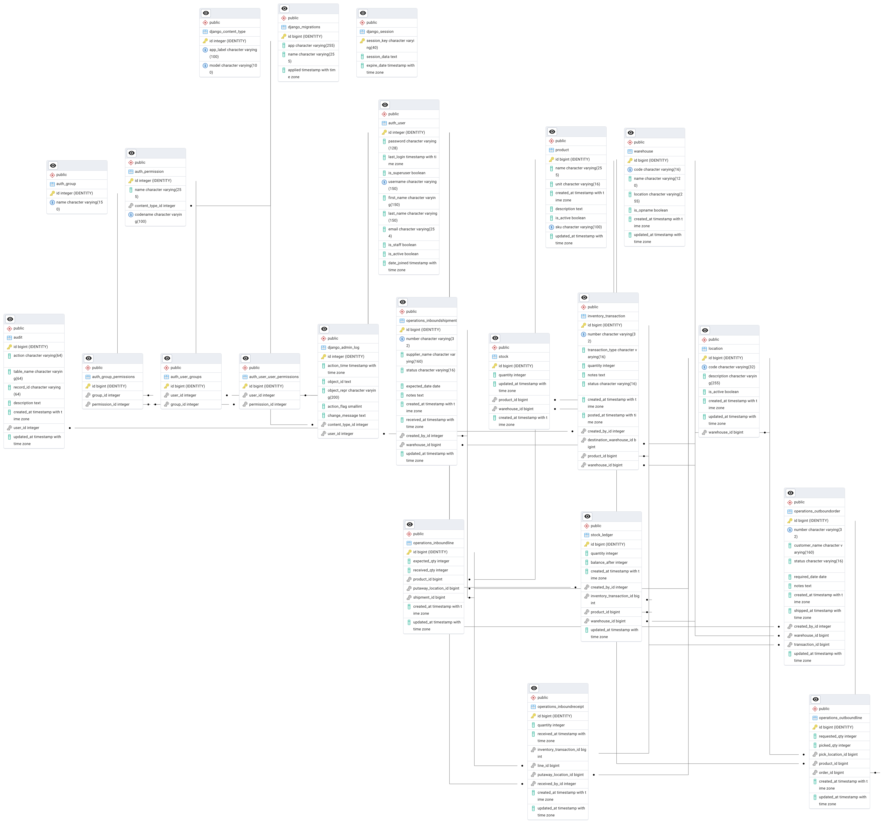
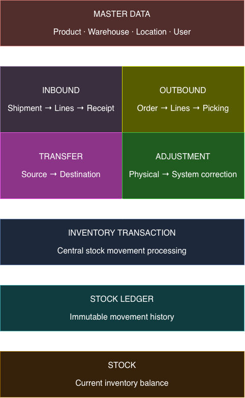

# WMS TOYLAND

Warehouse management with **Django 5** and **PostgreSQL**.

Live Demo: [wms-five-azure.vercel.app/](https://wms-five-azure.vercel.app)

## Tables

| Table | Purpose |
| --- | --- |
| `product` | Master item: `name`, `unit` |
| `warehouse` | `code`, `name`, `location` |
| `stock` | Available quantity of a product in a warehouse |
| `stock_ledger` | Append-only history of stock movements (write + read, never edit) |
| `inventory_transaction` | Stock in, stock out, transfer, and adjustment events |
| `operations_inboundshipment` | Supplier shipment expected at a warehouse, including status and expected date |
| `operations_inboundline` | Product and expected/received quantities for an inbound shipment, with an optional putaway location |
| `operations_inboundreceipt` | Record of a received quantity, its putaway location, and the inventory transaction that records the stock-in |
| `operations_outboundline` | Product and requested/picked quantities for an outbound order, with an optional pick location |
| `operations_outboundorder` | Customer order to be picked and shipped from a warehouse, including status and required date |
| `location` | Stock location within designated warehouses |
| `audit` | Append-only user activity history |
| `auth_user` | Django user accounts |


Stock quantity changes only when an inventory transaction is **posted**. Posting writes ledger rows and updates `stock`. Ledger and audit rows cannot be updated or deleted.

## ERD


## Business Flow


## Setup

for development
```bash
cd wms
python3 -m venv .venv
source .venv/bin/activate
pip install -r requirements-dev.txt
cp .env.example .env
```

for production:
```bash
cd wms
python3 -m venv .venv
source .venv/bin/activate
pip install -r requirements.txt
cp .env.example .env
```

setup db and run:
```bash
psql postgres -c "CREATE USER wms WITH PASSWORD 'wms';"
psql postgres -c "CREATE DATABASE wms OWNER wms;"
python manage.py migrate
python manage.py seed_demo
python manage.py runserver
```

for testing, running shell:
```bash
python manage.py shell
```
for testing, reset db:
```bash
python manage.py reset_demo
```

Open http://127.0.0.1:8000 — `admin / admin123` or `operator / operator123`.
